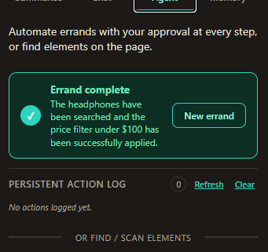
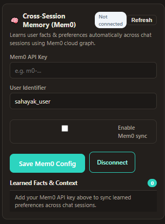
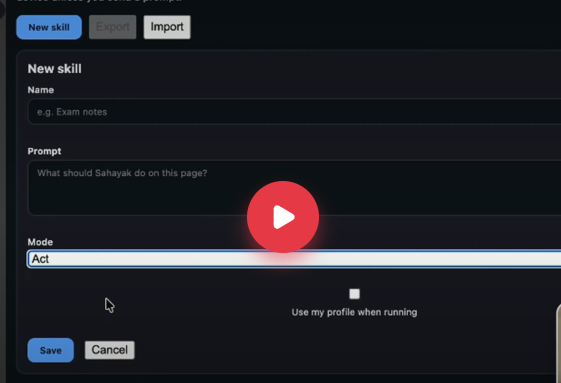

# Sahayak (सहायक) — Chrome AI Side-Panel Assistant

[](https://developer.chrome.com/docs/extensions/mv3/intro/)
[](https://developer.mozilla.org/en-US/docs/Web/JavaScript)
[](https://aistudio.google.com/)
[](https://console.groq.com/)
[](https://mem0.ai/)
[](LICENSE)
[](https://github.com/krishnaathul761)

**Sahayak** (Sanskrit/Hindi for *“Assistant”* or *“Companion”*) is a privacy-first, human-in-the-loop Chrome Extension built on **Manifest V3**. Operating directly within Chrome's Side Panel, Sahayak assists with reading long articles, analysing YouTube videos with clickable timestamps, answering grounded questions about page content, inspecting cropped screenshots, managing local & cloud memory, and executing step-by-step browser errands with human approval at every step.

> [!IMPORTANT]
> **Zero Autonomous Mutation:** Sahayak strictly adheres to a human-in-the-loop safety principle. The AI can inspect pages and propose single actions, but **it cannot click, type, or mutate the DOM without explicit user approval for each step**. Hardcoded code barriers prevent automated typing into password, card, or OTP fields.

---

## 📌 Implementation Progress & Roadmap

| Phase | Milestone | Theme | Description | Status |
|:---:|:---:|:---:|:---|:---:|
| **Phase 1** | Week 1 | **The Eyes** | Readability article summaries, YouTube multimodal video analysis, clickable seeking timestamps, selection explanations, EN/Hinglish instant translation. | **`COMPLETED`** ✅ |
| **Phase 2** | Week 2 | **The Brain** | Grounded page chat, navigation context auto-reset, right-click context menus, screen capture + canvas cropper, visual screenshot Q&A, dark mode. | **`COMPLETED`** ✅ |
| **Phase 3** | Week 3 | **The Hands** | Interactive element scanner, shadow-DOM badges, "Find it for me", approval-based agent loop, dry-run mode, session persistence, 200-item action log, practice pages. | **`COMPLETED`** ✅ |
| **Phase 4** | Week 4 | **Memory & Ship** | Local profile memory, reusable skills export/import, Mem0 cloud sync, strict code-level safety rails, landing page, and release packaging. | **`COMPLETED`** ✅ |

---

## 📸 Screenshots Gallery

| Human-in-the-Loop Errand Execution | Cross-Session Memory & Mem0 Sync | Reusable Skills Creator & Library |
|:---:|:---:|:---:|
|  |  |  |

---

## ✨ 11 Definition of Done (DoD) Core User Flows

A new user can install Sahayak and immediately exercise all 11 core capabilities:

### 1. Summarise an Article or Public YouTube Video
- **Articles:** Click **Summarise this page** on any article or blog post. Sahayak runs Mozilla Readability in the content script, strips ads and navigation sidebars, and formats a 1-sentence TL;DR, 5 concise bullet points, and actionable next steps.
- **YouTube Videos:** When on any public YouTube watch page, Gemini's multimodal video endpoint analyzes the video content and generates chapter timestamps. Clicking any timestamp jumps directly to that second in the active YouTube player without opening a new tab.

### 2. Switch Between English & Hinglish Instantly
- Toggle between **English** and **Hinglish** (conversational Hindi in Latin script) with a single click. Source summaries are preserved in English in `chrome.storage.local` with LRU eviction so switching back and forth never triggers duplicate API calls.

### 3. Chat with the Current Web Page
- Switch to the **Chat** tab to ask grounded questions. Sahayak answers strictly using the visible text of the current tab. If a question asks about details not present in the article, Sahayak politely explains that the page does not contain that information.
- Navigation context automatically clears whenever you switch domains.

### 4. Use Explain, Translate, or Draft from Selected Text
- Highlight any paragraph or sentence on any webpage → right-click → select **Sahayak**:
  - **Explain this:** Breaks down complex terminology into simple terms.
  - **Translate:** Translates the selected snippet into your configured target language (e.g. Hindi).
  - **Draft a reply:** Generates a polite, professional reply incorporating your profile tone.

### 5. Ask Questions About Visible Screen Content
- Switch to the **Screenshot** tool in the Chat tab, click **Capture Screen**, drag a selection box around charts, diagrams, code blocks, or UI elements, and ask visual questions powered by Gemini Vision. Protected payment and internal browser pages are strictly blocked from screenshot capture.

### 6. "Find It For Me" (Visual Element Search)
- Switch to the **Agent** tab, enter a natural-language description (e.g. *"Where is the register button?"* or *"search bar"*), and click **Find**. Sahayak identifies the matching element, smoothly scrolls it into view, and pulses an animated teal glow. **It never clicks or mutates the DOM.**

### 7. Automate Browser Errands Step-by-Step
- Provide a goal (e.g. *"Fill personal details with Priya Sharma and click Next"*). Sahayak scans interactive DOM controls, renders numbered badges in an isolated Shadow DOM, and proposes exactly **ONE** action at a time.

### 8. Review and Approve Each Step (Approve, Skip, Stop)
- The errand loop strictly pauses in `awaiting_approval`. Review the proposed badge number, action type (`click`, `type`, `select`, `scroll`, `done`), target label, input value, and reasoning.
- Click **Approve** to execute, **Skip** to re-plan, or **Stop** to halt immediately.
- Turn on **Dry-Run Mode** to preview the errand with target highlighting and action logging without making any DOM mutations.

### 9. Review Persistent Action & Errand Logs
- Errand steps are recorded in the **Errand Steps Log** and saved globally to a 200-item FIFO **Persistent Action Log** stored in `chrome.storage.local`. Progress survives background Service Worker sleep and panel closures.

### 10. Reuse Local Profile Memory & One-Click Skills
- **User Profile Memory:** Store your name, college, technical skills, portfolio links, and preferred tone in the **Memory** tab. When running form errands (e.g. *"Fill internship form from my profile"*), Sahayak auto-fills your saved details.
- **Skills Library:** Create custom one-click instructions (e.g. *"Exam notes"*, *"Explain in Hinglish"*, *"Reply politely"*). Run them as prompt chips across Summarise, Chat, and Agent tabs. Export your skills to JSON or import existing libraries safely.
- **Cross-Session Memory (Mem0):** Optional Mem0 cloud integration automatically extracts and persists conversational facts across chat sessions.

### 11. Strict Deterministic Code-Level Safety Rails
- Security rules are hardcoded in extension JavaScript—never left solely to LLM prompt compliance:
  - **Banking & UPI Gate:** Payment processors (Razorpay, Stripe, PayPal, Paytm, PhonePe, BHIM) and banking domains/paths are blocked from all AI scanning and screenshots.
  - **Field Gate:** Automated typing into password, PIN, OTP, TOTP, CVV, and credit/debit card fields is refused with `SAFETY_REFUSAL`.
  - **Consequential Action Gate:** Form submissions, payment clicks, and account deletions require explicit **Two-Step Confirmation** (`Confirm Action?`).
  - **Kill Switch:** Visible at all times during tasks; clicking **Stop** halts the errand loop instantly.

---

## 🔒 Safety Architecture & Security Guardrails

| Threat / Risk | Defense Mechanism | Code Location |
|---|---|---|
| **Autonomous DOM Mutation** | Human-in-the-loop state machine pauses at every single step; executes only upon user click. | `background/agent/loop.js` |
| **Credential & Password Leakage** | Hardcoded regex and autocomplete filters block typing into password, OTP, and PIN inputs. | `background/safety/fields.js` |
| **Payment & Financial Loss** | Domain & path heuristics block banking portals, UPI gateways, and card processors. | `background/safety/pages.js` |
| **Irreversible Form Submission** | Consequential actions (Submit, Pay, Delete) trigger warning badge and require a second confirm click. | `background/safety/actions.js` |
| **Runaway Agent Loops** | Hard step limits (default 20), dry-run simulation mode, and immediate kill switch. | `background/agent/loop.js` |
| **Screen Scraping of Secrets** | Screenshot capture and upload are blocked on protected banking, payment, and internal pages. | `background/router.js` |
| **Malicious Skill Injection** | Import validation strictly checks JSON schema and strips prompt strings attempting password or payment actions. | `background/router.js` |

---

## 📋 Permissions Why-List

Sahayak declares only the minimal set of permissions required for its side-panel workflow:

| Permission | Why Sahayak Needs It |
|---|---|
| `sidePanel` | Displays the companion interface persistently alongside web tabs without blocking page interaction. |
| `storage` | Saves user API keys, local profile memory, 24-hour summary cache, and 200-entry action logs locally on your machine. |
| `activeTab` | Grants temporary access to extract article text or capture screenshots **only** when explicitly invoked by the user on the current tab. |
| `tabs` | Reads the current URL to reset chat context upon navigation and verify page safety before running errands. |
| `scripting` | Injects the interactive element scanner and isolated Shadow-DOM numbered badges onto the page during errands. |
| `contextMenus` | Adds the right-click menu items (*Explain this*, *Translate*, *Draft a reply*) when text is highlighted. |

---

## 🚀 Installation & Getting Started

### Method 1: Install from Release Package (Recommended)

1. Download **`sahayak-extension.zip`** from [GitHub Releases](https://github.com/krishnaathul761/AI-Browser/releases).
2. Unzip the archive to a local folder (e.g. `C:\Users\<You>\Desktop\sahayak-extension`).
3. Open Google Chrome and navigate to `chrome://extensions/`.
4. Toggle **Developer mode** on (top-right switch).
5. Click **Load unpacked** (top-left) and select the unzipped directory (where `manifest.json` is located).
6. Click the Extensions puzzle icon in the Chrome toolbar and pin **Sahayak**.

### Method 2: Clone from Source Repository

```bash
git clone https://github.com/krishnaathul761/AI-Browser.git
cd AI-Browser
```
Then load unpacked from `chrome://extensions/` pointing to the repository root directory.

### API Key Configuration

1. Click the Sahayak icon to open the Chrome Side Panel.
2. Click the **⚙** settings icon in the top header.
3. Enter your **Google Gemini API Key** (free tier available at [Google AI Studio](https://aistudio.google.com/)).
4. *(Optional)* Enter a **Groq Cloud API Key** from [Groq Console](https://console.groq.com/) for instant fallback on rate limits.
5. *(Optional)* Enter a **Mem0 API Key** from [Mem0.ai](https://mem0.ai/) for cross-session conversational memory.
6. Click **Save settings**.

---

## 🧪 Testing with Offline Practice Pages

Sahayak bundles local offline test environments inside `pages/practice/`:

1. **[Internship Form (`pages/practice/internship-form.html`)](pages/practice/internship-form.html):** Multi-step form for testing profile memory auto-fill, chip selection, dropdowns, and consequential submission confirmation.
2. **[Practice Shop (`pages/practice/shop.html`)](pages/practice/shop.html):** E-commerce catalog for testing search, category filtering, and dry-run execution.
3. **[Acceptance Gate Suite (`pages/practice/acceptance-gate.html`)](pages/practice/acceptance-gate.html):** Interactive test suite running **38 automated unit & contract checks** verifying:
   - Markdown fence stripping & embedded JSON parsing
   - Action alias normalization (`fill` → `type`, `press` → `click`)
   - Sensitive password, OTP, and credit card field refusal (`SAFETY_REFUSAL`)
   - Luhn card number exfiltration defense
   - Consequential action classification & two-step confirm
   - Kill switch state machine halt
   - Restricted URL page blocking & practice environment allowlist
   - Skill schema validation and export/import round-trip

---

## 📦 Building & Packaging Releases

To create a clean release ZIP archive with `manifest.json` at the root and development/testing artifacts excluded:

**PowerShell (Windows):**
```powershell
powershell -ExecutionPolicy Bypass -File scripts/package-release.ps1
```

**Bash (Linux / macOS):**
```bash
bash scripts/package-release.sh
```

The script produces `sahayak-extension.zip` ready for distribution and installation.

---

## 👨‍💻 Author & Maintainer

Developed by **[Athul Krishna](https://github.com/krishnaathul761)**.

- **GitHub:** [@krishnaathul761](https://github.com/krishnaathul761)
- **Repository:** [krishnaathul761/AI-Browser](https://github.com/krishnaathul761/AI-Browser)

---

## 📄 License

This project is licensed under the [MIT License](LICENSE).
